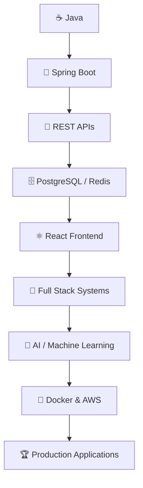

<!-- ══════════════════════════════════════════════════════════════════════════
     PRANAV RAMRAJE — GITHUB PROFILE README
     Full Stack Java Developer · M.Sc. Computer Science
     ══════════════════════════════════════════════════════════════════════════ -->

<!-- ──────────────────────────────── HERO ──────────────────────────────── -->

 

  

  

<!-- ─────────────────────────────── ABOUT ─────────────────────────────── -->

 

I'm an **M.Sc. Computer Science student** and a **Full Stack Java Developer** who loves turning real-world requirements into complete, production-ready software systems.

My core strength is the **Java + Spring Boot** ecosystem — designing clean REST APIs, modelling relational databases, and building secure authentication. On the frontend I craft modern interfaces with **React**, and I'm actively expanding into **AI / Machine Learning**, **Docker**, and **AWS**.

I care about **clean architecture**, **readable code**, and **systems that actually solve problems**.

 

<table align="center">
<tr>
<td align="center" width="25%">
  <h3>🎯</h3>
  <b>Focus</b> 
  Spring Boot · React PostgreSQL
</td>
<td align="center" width="25%">
  <h3>🌱</h3>
  <b>Learning</b> 
  Docker · AWS System Design
</td>
<td align="center" width="25%">
  <h3>🤖</h3>
  <b>Exploring</b> 
  AI / ML Data Engineering
</td>
<td align="center" width="25%">
  <h3>🚀</h3>
  <b>Building</b> 
  Real-World Full Stack Apps
</td>
</tr>
</table>

 

> **Build. Learn. Improve. Repeat.**

<!-- ───────────────────────────── TECH STACK ───────────────────────────── -->

 

<h3 align="center">💻 &nbsp;Languages</h3>

  

<h3 align="center">⚙️ &nbsp;Backend</h3>

  

  Java · Spring Boot · Spring Security · Spring Data JPA · REST APIs · FastAPI

<h3 align="center">🎨 &nbsp;Frontend</h3>

  

  React · Angular · HTML5 · CSS3 · JavaScript · TypeScript

<h3 align="center">🗄️ &nbsp;Databases</h3>

  

  PostgreSQL · MySQL · Redis · SQL · Database Design

<h3 align="center">🤖 &nbsp;AI / Machine Learning</h3>

  

  PyTorch · XGBoost · LSTM · Machine Learning · Data Analysis

<h3 align="center">☁️ &nbsp;Tools &amp; DevOps</h3>

  

  Git · GitHub · Docker · AWS · Linux · VS Code · Postman

<!-- ────────────────────────── FEATURED PROJECTS ────────────────────────── -->

 

<table>
<tr>

<td width="33%" valign="top" align="center">

<h3>🏢 RPR Trades</h3>
<b>Import / Export Marketplace</b>

  

A full-stack trade management platform handling importer, exporter &amp; admin workflows end-to-end.

  

👤 Importer &amp; Exporter Registration 
🔐 Authentication &amp; Authorization 
📦 Product Management 
🛒 Order Management 
💳 Payment Management 
🧾 Invoice Generation 
🚚 Shipment Tracking 
👨‍💼 Admin Monitoring 
📊 Business Reports

  

  

</td>

<td width="33%" valign="top" align="center">

<h3>🤖 AI Recruitment ATS</h3>
<b>AI-Powered Recruitment System</b>

  

An Applicant Tracking System managing recruitment workflows, candidates, jobs and applications.

  

👤 Candidate Management 
💼 Job Management 
📄 Application Processing 
🔐 Authentication 
🏢 Recruiter Workflow 
🤖 AI / ML Integration 
📊 Recruitment Management 
📈 Recruitment Reports

  

  

</td>

<td width="33%" valign="top" align="center">

<h3>📈 Trading Platform</h3>
<b>Market Analysis &amp; Trading</b>

  

A comprehensive trading platform combining real-time market data, advanced charts and AI/ML strategies.

  

📊 Real-Time Market Data 
🕯️ Historical Candles 
📈 TradingView Charts 
🔌 WebSocket Streams 
💱 Binance Integration 
💹 MetaTrader 5 
🤖 AI / ML Strategies 
⚠️ Risk Management 
🧪 Backtesting

  

  

</td>

</tr>
</table>

<!-- ─────────────────────────── GITHUB ANALYTICS ─────────────────────────── -->

 

 

 

<!-- ────────────────────────── CONTRIBUTION ACTIVITY ────────────────────── -->

 

 

<picture>
  <source media="(prefers-color-scheme: dark)" srcset="https://raw.githubusercontent.com/PranavRPR/PranavRPR/output/github-contribution-grid-snake-dark.svg" />
  <source media="(prefers-color-scheme: light)" srcset="https://raw.githubusercontent.com/PranavRPR/PranavRPR/output/github-contribution-grid-snake.svg" />
  
</picture>

<!-- ──────────────────────────── CURRENT FOCUS ──────────────────────────── -->

 

<!-- ─────────────────────────────── CONNECT ─────────────────────────────── -->

 

### 💬 &nbsp;Open to collaboration, freelance &amp; full-time opportunities

 

  

<!-- ─────────────────────────────── FOOTER ──────────────────────────────── -->

